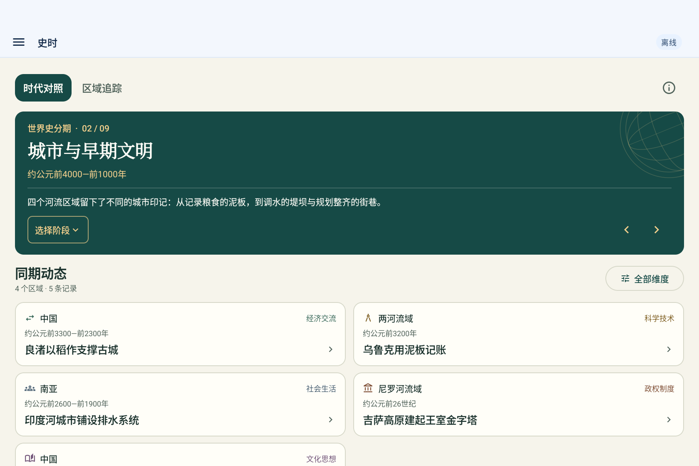

# 史时 · 设计初稿与需求评估

在云端工作台主菜单打开「浏览」下方的「史时」。初稿默认翻到「城市与早期文明」，第一屏即可比较中国、两河流域、南亚和尼罗河流域。「上一阶段」可回到史前聚落，「选择阶段」可直接跳到当代。

## 两种读法

| 想了解什么 | 阅读路径 | 界面取舍 |
| --- | --- | --- |
| 同一时期，各地如何形成城市？ | 时代对照 → 城市与早期文明 → 并读良渚、乌鲁克、摩亨佐达罗和吉萨 | 先看阶段、年代和一段导读，再比较带有区域、维度、时间的事件卡。宽屏双列，窄屏单列。 |
| 一个地区后来如何变化？ | 良渚以稻作支撑古城 → 追踪中国的历史 | 区域沿革按阶段分组。可继续读殷墟甲骨、秦统一、隋代运河直至嫦娥六号。 |
| 某项变化在其他地区有什么同时期的参照？ | 区域追踪 → 日本列岛 → 科学技术 → 东海道新干线开通 → 对照这个阶段的其他区域 | 详情页可直接在两种视图间切换，进入相应阶段或区域。 |

## 需求实现度

| 需求 | 实现情况 | 评估 |
| --- | --- | --- |
| 菜单入口与名称 | 原生抽屉从上到下显示云端、会话、浏览、史时，设置仍在底部 | 已实现，自动化核对了「浏览」和「史时」的实际纵向位置。[菜单截图](menu.png) |
| 从古至今的分期 | 9 个阶段，所收节点从约公元前13000年到2026年 | 采用可查的世界史教学分期。相邻阶段允许重叠，事件按主要历史语境归入一处。[UCLA 世界史教学标准](https://phi.history.ucla.edu/nchs/world-history-content-standards/) |
| 区域跟踪 | 四条文明区域线延伸至后世，现代重点为中、美、俄、英、法、印、日、德、巴西。中国与南亚跨两组，共 11 条线 | 以安理会五个常任理事国及四国集团成员选取当代样本。地域标签与事件发生时的政权名称分别标示。[联合国安理会成员](https://main.un.org/securitycouncil/en/content/current-members) · [联合国关于四国集团的资料](https://ask.un.org/faq/269232) |
| 多维度展示 | 政权制度 25 条、经济交流 13 条、社会生活 7 条、科学技术 7 条、文化思想 5 条 | 两种视图均支持按主维度筛选，零结果时可一键恢复。政治制度记录最丰富，文化思想最薄。 |
| 信息层级 | 阶段导读 → 同期事件 → 背景与意义；区域简介 → 分期时间线 → 事件详情 | 原生页面可离线阅读。外部延伸阅读需要联网。 |
| 史料与完整性 | 共 57 条精选记录，其中 20 条附直达博物馆、遗产机构或其他一手机构的资料链接 | 当前是可使用的选编初稿。各地史料密度不同，仍有 37 条待补逐条引文，完整编年和史学专家审校尚待完成。 |

## 验证范围

独立验收包完成 Debug 构建及 Android Lint 检查。Android 15 模拟器使用手机窄屏与平板宽屏分别验证菜单、阶段前后切换、区域下钻、主题筛选、菜单往返后的状态恢复和无结果提示。图中展示 APP 的实际画面。TB322FC 实体平板已安装独立验收包，实体屏幕的视觉验收待解锁后进行。
