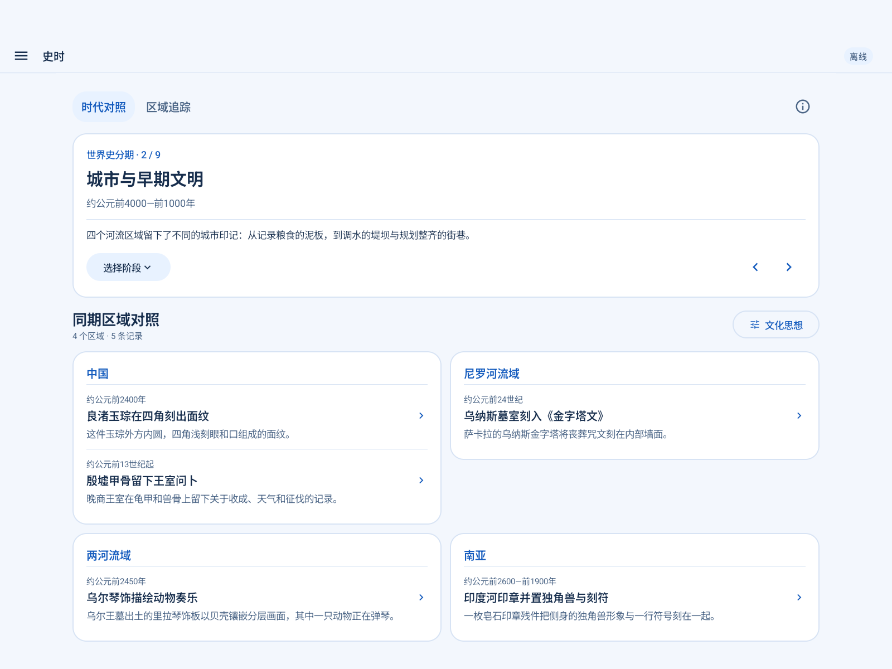
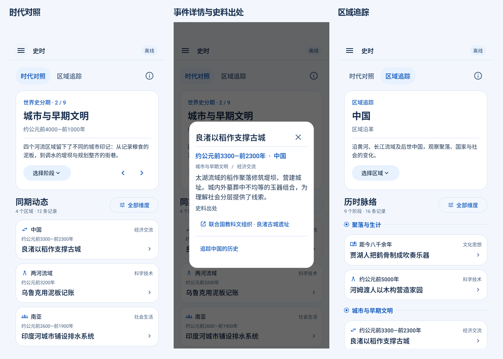

# 史时 · 内容、界面与验收

打开云端工作台主菜单「浏览」下方的「史时」。模块提供 9 个世界史阶段、11 条区域线和 82 条离线记录。每条详情都有具名出处，点开可访问相应馆藏、文书、研究文章或机构资料。[逐条史料索引](史料索引.md)

## 同一阶段怎样比较不同区域

进入「时代对照 → 城市与早期文明」，在右侧的维度筛选中选择「文化思想」或「社会生活」。每个区域占一张卡，卡内保留各条记录的年代、标题与材料摘要。两个维度使用相同的区域顺序，宽屏双列，手机单列。

| 区域 | 文化思想 · 如何记录信仰和想象 | 社会生活 · 什么留下了日常活动的线索 |
| --- | --- | --- |
| 中国 | 约公元前2400年的良渚玉琮把面纹刻在四角；晚商甲骨记录具体的问卜事项。 | 商末周初孝民屯的陶范留下工匠制作青铜酒器的痕迹。 |
| 尼罗河流域 | 约公元前24世纪，乌纳斯金字塔的墓室墙面刻入帮助国王进入来世的咒文。 | 约公元前13世纪，工匠孔苏一家数代参与修建王墓，家族墓保存了他们的姓名。 |
| 两河流域 | 约公元前2450年的乌尔琴饰用贝壳镶出动物奏乐的画面。 | 乌尔王墓出土的二十格棋盘保留了格子、图案和镶片，可据此复原棋盘布局。 |
| 南亚 | 哈拉帕文明的印章并置独角兽形象与尚待释读的符号。 | 摩亨佐达罗的砖屋、街巷和排水设施，留下居民共同安排城市用水的证据。 |

时期是跨区域比较的时间范围，每张卡的年代用于判断两条记录相隔多久。墓葬与宫廷材料尤其容易留存，不能据此推定所有人的生活方式。[社会生活对照实拍](society.png) · [各项材料出处](史料索引.md)

## 内容变化

| 维度 | 原有 | 新增 | 现有 |
| --- | ---: | ---: | ---: |
| 政权制度 | 25 | 0 | 25 |
| 经济交流 | 13 | 0 | 13 |
| 科学技术 | 7 | 0 | 7 |
| 文化思想 | 5 | 14 | 19 |
| 社会生活 | 7 | 11 | 18 |
| **合计** | **57** | **25** | **82** |

原有 37 条缺引记录已逐条补齐，原有 20 条来源保留。新增记录从史前贾湖骨笛延伸到当代印度学校膳食计划。资料类型包括出土器物、法律与档案原文，以及博物馆、大学和历史研究机构的解释。记录同时列出机构或作者、资料名称及直达链接。

## 导航与验收

时代页可前后翻页或跳选阶段；区域页按时期串联同一地区的记录。由事件详情可切换到相应区域或时期。页面背景、卡片、选中态、正文和按钮均使用云端工作台的主题、面板和字体样式。[平板总览](tablet.png) · [菜单入口](menu.png)

已核对旧版 57 条记录全部保留、原有出处未丢失，82 条的来源名和 HTTPS 地址均已填写。Debug 构建与 Android Lint 通过。Android 15 手机和平板模拟器分别通过导航、筛选、区域对照及出处展示两项验收用例。0.4.77（90）另在 TB322FC 实体平板（Android 16，1904 × 3040）通过两项交互验收。早期文明阶段切换文化思想与社会生活时，四区域顺序保持一致，分别显示 5 条和 4 条记录。真机从事件详情打开大都会艺术博物馆的良渚玉琮藏品页与中国社会科学网的孝民屯研究文章，均核对到对应正文。外部资料页的访问取决于网络和来源站点。

分期沿用 [UCLA 世界史教学标准](https://phi.history.ucla.edu/nchs/world-history-content-standards/)。当代观察样本包含安理会五个常任理事国及四国集团成员。[联合国安理会成员](https://main.un.org/securitycouncil/en/content/current-members) · [联合国关于四国集团的资料](https://ask.un.org/faq/269232)
